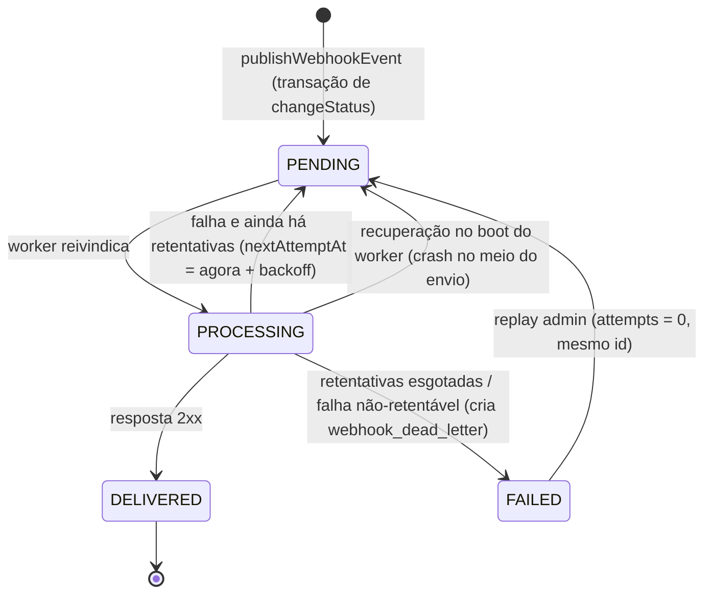

# FDD — Sistema de Webhooks de Notificação de Pedidos

| Campo | Valor |
|---|---|
| **Feature** | Webhooks de saída para mudança de status de pedido |
| **Status** | Rascunho para a sessão de revisão do design ([09:50] Larissa). Pendente: RFC Q-05/Q-06/Q-07 e revisão de segurança ([09:46] Sofia). |
| **Base** | [RFC](RFC.md) · [ADR-001…007](adrs/) · [PRD](PRD.md) |
| **Data** | 2026-10-24 |

> **Convenção de origem.** Toda regra deste documento cita sua fonte, `[hh:mm] Nome` (transcrição) ou um caminho do código. Os itens marcados como **(proposta de implementação)** são detalhes que a reunião não decidiu e que este FDD propõe para destravar o desenvolvimento. Eles estão consolidados na §14 para validação na sessão de revisão do design ([09:50] Larissa). Arquivos marcados como **(novo)** ainda não existem no repositório.

---

## 1. Contexto e motivação técnica

Hoje o OMS não tem nenhum mecanismo de notificação externa. Clientes B2B fazem polling em `GET /api/v1/orders` para descobrir mudanças de status ([09:00] Marcos). Toda transição passa por `OrderService.changeStatus` (`src/modules/orders/order.service.ts`), que, dentro de `this.prisma.$transaction(async (tx) => …)`:

1. carrega o pedido com os itens;
2. valida a transição com `canTransition` (`src/modules/orders/order.status.ts`);
3. debita ou repõe estoque (`shouldDebitStock` / `shouldReplenishStock`);
4. atualiza `orders.status` e grava `order_status_history`;
5. relê o pedido com as relações e o devolve.

O requisito é notificar em menos de 10s ([09:02] Marcos) sem acoplar a transação a chamadas HTTP externas ([09:04] Bruno). A solução decidida é Outbox + worker separado ([ADR-001](adrs/ADR-001-outbox-transacional-no-mysql.md), [ADR-002](adrs/ADR-002-worker-separado-com-polling.md)).

## 2. Objetivos técnicos

| # | Objetivo | Origem |
|---|---|---|
| OT-01 | Status alterado ⇔ evento gravado na outbox (mesma transação, rollback conjunto) | [09:40] Bruno, [09:41] Diego |
| OT-02 | Primeira tentativa de entrega em até ~2s após o commit (polling de 2s), dentro do teto de 10s | [09:02] Marcos, [09:10] Larissa |
| OT-03 | Nenhuma chamada HTTP externa dentro do processo/transação da API | [09:04] Bruno, [09:11] Diego |
| OT-04 | Entrega at-least-once com `X-Event-Id` estável entre retries e replay | [09:24]–[09:25] Diego |
| OT-05 | Retry 1m/5m/30m/2h/12h e depois DLQ em `webhook_dead_letter` | [09:17] Larissa, [09:18] Diego |
| OT-06 | Toda requisição assinada com HMAC-SHA256 usando a secret do endpoint | [09:22] Sofia |
| OT-07 | Zero dependências novas de runtime: Prisma, Pino, Zod, Express, `uuid` e `node:crypto`/`fetch` nativos | [09:30] Larissa ("reuso máximo"), `package.json` |

## 3. Escopo e exclusões

**Incluso**
- Módulo `src/modules/webhooks/` (novo): CRUD de configuração, rotação de secret, histórico de entregas, replay de DLQ ([09:31]–[09:36]).
- `publishWebhookEvent(tx, order, fromStatus, toStatus)` chamada por `changeStatus` ([09:41] Bruno).
- Worker `src/worker.ts` (novo) + `src/modules/webhooks/webhook.worker.ts` (novo) ([09:11] Larissa, [09:28] Bruno).
- Quatro tabelas novas via migration Prisma (§4).

**Excluído** (com origem)

| Item | Origem |
|---|---|
| Webhooks de entrada (cliente → plataforma) | [09:02] Marcos |
| E-mail ou alerta ao cliente após falhas seguidas | [09:37] Larissa |
| Rate limiting de saída por cliente (observar) | [09:39] Larissa |
| Dashboard visual para o cliente | [09:40] Larissa |
| Arquivamento de eventos entregues (~30 dias) | [09:08] Diego |
| Múltiplos workers / ordering global | [09:13] Diego |
| Restrição de role no CRUD de configuração (por ora, qualquer usuário autenticado) | [09:37] Sofia |
| Evento na **criação** do pedido (`null → PENDING` em `OrderService.create`, que não passa por `changeStatus`) | Escopo da reunião = mudança de status ([09:40] Bruno). Ver §14. |

## 4. Modelo de dados

Proposta para `prisma/schema.prisma`, seguindo as convenções do arquivo: `id String @id @default(uuid()) @db.Char(36)` ([09:51] Larissa), `createdAt`/`updatedAt`, `@@map` em snake_case e reaproveitamento do enum `OrderStatus`.

```prisma
enum WebhookOutboxStatus {
  PENDING      // pendente
  PROCESSING   // processando
  FAILED       // falhou (movido para DLQ)
  DELIVERED    // entregue
}

model WebhookEndpoint {
  id                      String    @id @default(uuid()) @db.Char(36)
  customerId              String    @db.Char(36)
  url                     String    @db.VarChar(2048)
  secret                  String    @db.VarChar(128)
  previousSecret          String?   @db.VarChar(128)
  previousSecretExpiresAt DateTime?
  events                  Json      // OrderStatus[] — filtro de status assinados
  active                  Boolean   @default(true)
  createdAt               DateTime  @default(now())
  updatedAt               DateTime  @updatedAt

  customer   Customer            @relation(fields: [customerId], references: [id], onDelete: Cascade)
  outbox     WebhookOutbox[]
  deliveries WebhookDelivery[]

  @@index([customerId])
  @@map("webhook_endpoints")
}

model WebhookOutbox {
  id            String              @id @default(uuid()) @db.Char(36) // = event_id / X-Event-Id
  webhookId     String              @db.Char(36)
  orderId       String              @db.Char(36)                      // sem FK: snapshot independe do pedido
  eventType     String              @db.VarChar(64)                   // "order.status_changed"
  payload       Json                                                  // snapshot renderizado na inserção
  status        WebhookOutboxStatus @default(PENDING)
  attempts      Int                 @default(0)
  nextAttemptAt DateTime            @default(now())
  lastError     String?             @db.VarChar(500)
  deliveredAt   DateTime?
  createdAt     DateTime            @default(now())
  updatedAt     DateTime            @updatedAt

  webhook    WebhookEndpoint     @relation(fields: [webhookId], references: [id], onDelete: Cascade)
  deliveries WebhookDelivery[]
  deadLetters WebhookDeadLetter[]

  @@index([status])
  @@index([createdAt])
  @@index([orderId])
  @@map("webhook_outbox")
}

model WebhookDelivery {
  id             String   @id @default(uuid()) @db.Char(36)
  outboxId       String   @db.Char(36)
  webhookId      String   @db.Char(36)
  attemptNumber  Int
  success        Boolean
  responseStatus Int?
  responseBody   String?  @db.Text      // truncado (proposta: 4KB)
  durationMs     Int
  errorCode      String?  @db.VarChar(64) // WEBHOOK_DELIVERY_*
  createdAt      DateTime @default(now())

  outbox  WebhookOutbox   @relation(fields: [outboxId], references: [id], onDelete: Cascade)
  webhook WebhookEndpoint @relation(fields: [webhookId], references: [id], onDelete: Cascade)

  @@index([webhookId, createdAt])
  @@map("webhook_deliveries")
}

model WebhookDeadLetter {
  id           String    @id @default(uuid()) @db.Char(36)
  outboxId     String    @db.Char(36)       // N por evento: um replay pode voltar à DLQ
  payload      Json
  reason       String    @db.VarChar(64)   // código WEBHOOK_* da falha final
  lastError    String?   @db.VarChar(500)
  failedAt     DateTime  @default(now())
  replayedAt   DateTime?
  replayedById String?   @db.Char(36)      // auditoria do replay ([09:36] Sofia)

  outbox WebhookOutbox @relation(fields: [outboxId], references: [id], onDelete: Cascade)

  @@index([outboxId])
  @@index([failedAt])
  @@map("webhook_dead_letter")
}
```

Notas:
- `Customer` ganha a back-relation `webhookEndpoints WebhookEndpoint[]` (exigência do Prisma). O `onDelete: Cascade` evita que endpoints bloqueiem `CustomerService.delete` (`src/modules/customers/customer.service.ts`). **(proposta de implementação)**
- Os índices `status` e `createdAt` da outbox são os citados por Diego ([09:08]). `orderId` serve à investigação por pedido.
- Os campos da DLQ (payload, motivo, timestamp) vêm de [09:18] Diego. `replayedAt`/`replayedById` atendem a auditoria de [09:36] Sofia.
- `secret`/`previousSecret` precisam ficar recuperáveis para assinar ([ADR-004](adrs/ADR-004-hmac-sha256-com-secret-por-endpoint.md)). A proteção em repouso fica para a revisão de segurança (RFC Q-07).

### 4.1 Máquina de estados da outbox



## 5. Fluxos detalhados

### 5.1 Criação do evento na outbox (dentro de `changeStatus`)

```mermaid
sequenceDiagram
  participant C as OrderController.changeStatus
  participant S as OrderService.changeStatus
  participant P as publishWebhookEvent
  participant DB as MySQL (tx)
  C->>S: changeStatus(id, {toStatus, reason}, userId)
  S->>DB: BEGIN; SELECT order + items
  S->>S: canTransition / estoque
  S->>DB: UPDATE orders; INSERT order_status_history
  S->>P: publishWebhookEvent(tx, order, from, to)
  P->>DB: SELECT webhook_endpoints WHERE customerId AND active
  P->>P: filtra endpoints cujo events contém `to`
  alt nenhum endpoint assina `to`
    P-->>S: 0 (nada inserido)
  else há assinantes
    P->>DB: INSERT webhook_outbox (1 linha por endpoint, payload snapshot)
    P-->>S: n
  end
  S->>DB: SELECT order refreshed; COMMIT
  Note over S,DB: Qualquer erro em P propaga e faz ROLLBACK de tudo
```

Regras:
1. A chamada fica **depois** de `tx.orderStatusHistory.create` e **antes** do `findUnique` de refresh, dentro do mesmo callback de `$transaction` ([09:40] Bruno).
2. **Filtro na inserção:** só endpoints `active = true` do `order.customerId` cujo `events` contém `toStatus` ([09:34] Bruno). O filtro é feito em memória sobre os poucos endpoints do customer. **(proposta de implementação)**
3. **Uma linha por endpoint assinante**, cada uma com seu próprio `id` UUID, que é o `event_id` ([09:25] Diego). Isso permite secret, `X-Webhook-Id` e ciclo de retry independentes por destino ([09:44] Sofia). **(proposta de implementação)**
4. **Payload renderizado agora** (snapshot, [09:52] Larissa) com os campos da §6.9. `order` é o objeto carregado no início da transação. `from_status`/`to_status` vêm dos parâmetros.
5. **Falha:** a função não engole erros. Ela registra `logger.error({ err, orderId, toStatus }, 'webhook_publish_failed')` e relança como `WebhookPublishError` (`WEBHOOK_PUBLISH_FAILED`, 500). O `$transaction` faz rollback e a mudança de status não acontece ([09:40] Bruno). O log explícito é necessário porque o `error.middleware.ts` **não loga** `AppError`, só erros não tratados.

Assinatura proposta (`src/modules/webhooks/webhook.publisher.ts`, novo):

```ts
export async function publishWebhookEvent(
  tx: Prisma.TransactionClient,
  order: Order,
  fromStatus: OrderStatus,
  toStatus: OrderStatus,
): Promise<number>; // quantidade de eventos enfileirados
```

### 5.2 Processamento pelo worker

```mermaid
sequenceDiagram
  participant W as webhook.worker (loop 2s)
  participant DB as MySQL
  participant CL as Endpoint do cliente
  loop a cada 2s
    W->>DB: SELECT webhook_outbox WHERE status=PENDING AND nextAttemptAt<=now ORDER BY createdAt LIMIT N
    loop para cada evento (sequencial)
      W->>DB: UPDATE SET status=PROCESSING WHERE id=? AND status=PENDING
      W->>DB: SELECT webhook_endpoints (url, secret, active)
      W->>W: valida (ativo, https, ≤64KB), assina HMAC
      W->>CL: POST url (timeout 10s)
      alt 2xx
        W->>DB: tx: UPDATE status=DELIVERED, deliveredAt; INSERT webhook_deliveries(success)
      else falha
        W->>DB: tx: INSERT webhook_deliveries(falha); retry (§5.3) ou DLQ (§5.4)
      end
    end
  end
```

Regras:
1. **Intervalo:** 2s entre o fim de um ciclo e o início do próximo ([09:09] Diego). Usar `setTimeout` encadeado, não `setInterval`, para nunca sobrepor ciclos. **(proposta de implementação)**
2. **Batch pequeno** ([09:08] Diego): constante `WEBHOOK_BATCH_SIZE = 10`. **(proposta de implementação)**
3. **Processamento sequencial em ordem de `createdAt`.** É isso que garante a ordem por pedido no modelo single-worker ([09:12] Diego). Não paralelizar envios dentro do batch.
4. **Reivindicação:** `updateMany({ where: { id, status: 'PENDING' }, data: { status: 'PROCESSING' } })`. Se `count === 0`, pular o evento. Isso protege contra execução acidental de dois workers, sem prometer ordering nesse cenário.
5. **Pré-envio** (falhas não-retentáveis vão direto para a DLQ, §5.4):
   - endpoint inexistente ou `active = false` → `WEBHOOK_INACTIVE`;
   - URL não-`https` (defesa em profundidade além do Zod) → `WEBHOOK_INVALID_URL`;
   - corpo serializado > 64KB → `WEBHOOK_PAYLOAD_TOO_LARGE` ([09:23] Sofia, [09:24] Diego). **Nunca truncar.**
6. **Envio:** `fetch` nativo do Node ≥ 20 (`package.json` → `engines.node`), `method: 'POST'`, headers da §6.9, `AbortSignal.timeout(10_000)` ([09:42] Diego), `redirect: 'error'` (um redirect poderia levar a uma URL não-https, [09:23] Sofia). **(proposta de implementação)**
7. **Sucesso = qualquer status 2xx.** Qualquer outra coisa (não-2xx, timeout, erro de rede/TLS) é falha retentável.
8. **Registro:** toda tentativa gera uma linha em `webhook_deliveries` com status HTTP, corpo da resposta truncado, `durationMs` e `errorCode`. É a base do `GET /webhooks/:id/deliveries` ([09:34] Marcos).

### 5.3 Retry com backoff exponencial

| Envio que falhou | Próxima tentativa em | Acumulado desde a 1ª falha |
|---|---|---|
| Envio inicial | 1ª retentativa em +1 min | 1 min |
| 1ª retentativa | 2ª retentativa em +5 min | 6 min |
| 2ª retentativa | 3ª retentativa em +30 min | 36 min |
| 3ª retentativa | 4ª retentativa em +2 h | 2h36 |
| 4ª retentativa | 5ª retentativa em +12 h | 14h36 |
| 5ª retentativa | → DLQ (tentativas esgotadas) | — |

- `WEBHOOK_BACKOFF_SCHEDULE_MS = [60_000, 300_000, 1_800_000, 7_200_000, 43_200_000]` ([09:17] Diego/Larissa).
- `WEBHOOK_MAX_RETRIES = 5` (= `WEBHOOK_BACKOFF_SCHEDULE_MS.length`): as **5 tentativas** decididas ([09:15] Diego, [09:17] Larissa) são as 5 retentativas, cada uma precedida de um dos cinco intervalos. É a única leitura que usa toda a progressão decidida e fecha com "quase 15 horas" (justificativa em [ADR-003](adrs/ADR-003-retry-backoff-exponencial-e-dlq.md)). **Ponto a confirmar (RFC Q-06):** se o time contar o envio inicial dentro das 5, basta remover o último intervalo da constante; o desenho não muda.
- `attempts` conta os envios já feitos (inicial + retentativas). Numa falha com `attempts <= WEBHOOK_MAX_RETRIES`: `status = PENDING`, `nextAttemptAt = now + SCHEDULE[attempts - 1]`, `lastError` preenchido. Tudo numa transação junto com o `INSERT` em `webhook_deliveries`.
- Os intervalos são fixos, sem jitter: o desenho tem um único worker e a reunião definiu valores exatos.

### 5.4 DLQ

Quando a 5ª retentativa falha (`attempts > WEBHOOK_MAX_RETRIES`) ou numa falha não-retentável (§5.2, item 5), numa única transação:
1. `webhook_outbox.status = FAILED`, `lastError`;
2. `INSERT webhook_dead_letter { outboxId, payload, reason, lastError, failedAt }` ([09:18] Diego);
3. `logger.warn({ eventId, webhookId, orderId, reason }, 'webhook_dead_lettered')`.

`reason` usa os códigos da §7: `WEBHOOK_MAX_ATTEMPTS_EXCEEDED`, `WEBHOOK_PAYLOAD_TOO_LARGE`, `WEBHOOK_INACTIVE`, `WEBHOOK_INVALID_URL`. Um evento que volta à DLQ depois de um replay ganha uma **nova** linha (não há unicidade por `outboxId`), o que preserva o histórico de cada ciclo de falha.

### 5.5 Replay manual

`POST /api/v1/admin/webhooks/dead-letter/:id/replay` (§6.8), role `ADMIN` ([09:36] Sofia/Larissa). Numa transação:
1. Carregar a dead letter. Se não existir → `WEBHOOK_DEAD_LETTER_NOT_FOUND`.
2. Se a dead letter já tiver `replayedAt` ou se o evento da outbox não estiver `FAILED` (já foi reenfileirado) → `WEBHOOK_REPLAY_CONFLICT`.
3. Na outbox, o **mesmo registro** (mesmo `id` = mesmo `X-Event-Id`, [ADR-005](adrs/ADR-005-entrega-at-least-once-com-x-event-id.md)) volta para `PENDING`, com `attempts = 0`, `nextAttemptAt = now` e `lastError = null` ([09:18] Diego).
4. Na dead letter: `replayedAt = now`, `replayedById = req.user.id`.
5. `logger.info({ deadLetterId, eventId, adminUserId, adminEmail }, 'webhook_dead_letter_replayed')`, o log de auditoria pedido em [09:36] Sofia.

O payload reenviado é o snapshot original ([09:52] Larissa). Se o endpoint continuar inativo, o evento volta para a DLQ com `WEBHOOK_INACTIVE`.

### 5.6 Rotação de secret

`POST /api/v1/webhooks/:id/rotate-secret` (§6.6) ([09:21] Sofia):
1. `previousSecret = secret`, `previousSecretExpiresAt = now + 24h`, `secret = nova secret`.
2. Uma nova rotação dentro do grace period descarta a anterior imediatamente (só existe um `previousSecret`). **(proposta de implementação)**
3. Depois de `previousSecretExpiresAt`, o worker ignora `previousSecret`. A limpeza do campo é preguiçosa: acontece na próxima rotação ou atualização.
4. **Geração:** `crypto.randomBytes(32).toString('hex')` (`node:crypto`). **(proposta de implementação, sujeita à revisão da Sofia [09:46])**

## 6. Contratos públicos

### 6.1 Convenções
- Prefixo `/api/v1` (`src/app.ts`). Todos os endpoints exigem `Authorization: Bearer <jwt>` (`authenticate` em `src/middlewares/auth.middleware.ts`).
- O CRUD aceita qualquer role autenticada ([09:37] Sofia). O replay exige `ADMIN` ([09:36] Sofia).
- `customerId` **não vem do JWT**: o JWT é do usuário operador ([09:32] Bruno, [09:32] Larissa). Seguindo as duas opções citadas ("no body ou no path"), ele vai **no body** da criação e **no path** da listagem (RFC Q-05). **(proposta de implementação)**
- A API de configuração usa camelCase, como o restante da API (por exemplo, `customerId` em `src/modules/orders/order.schemas.ts`). O payload **enviado ao cliente** usa snake_case, conforme definido em [09:43] Diego.
- A listagem de webhooks é paginada no formato `{ data, pagination }` de `src/shared/http/response.ts`.
- Erros no formato do `src/middlewares/error.middleware.ts`: `{ "error": { "code", "message", "details?" } }`.
- **A secret nunca aparece em respostas**, exceto na criação e na rotação ([09:31] Marcos).

### 6.2 `POST /api/v1/webhooks` — cadastrar webhook ([09:31] Marcos)

Request:
```http
POST /api/v1/webhooks
Authorization: Bearer eyJhbGciOi...
Content-Type: application/json

{
  "customerId": "3f6c1a2e-8f7b-4c1d-9a55-2b7e9d0c4a11",
  "url": "https://hooks.atlascomercial.com.br/oms/orders",
  "events": ["SHIPPED", "DELIVERED"]
}
```
Schema Zod (`webhook.schemas.ts`, novo): `customerId: z.string().uuid()`, `url: z.string().url().max(2048).refine(u => u.startsWith('https://'))` ([09:23] Sofia), `events: z.array(z.nativeEnum(OrderStatus)).min(1)` ([09:33] Marcos), com `.strict()` para recusar `secret` enviado pelo cliente.

Response `201 Created`:
```json
{
  "id": "9b1e4f0a-6c2d-4e8b-b1a3-7d5c2e9f0a42",
  "customerId": "3f6c1a2e-8f7b-4c1d-9a55-2b7e9d0c4a11",
  "url": "https://hooks.atlascomercial.com.br/oms/orders",
  "events": ["SHIPPED", "DELIVERED"],
  "active": true,
  "secret": "4b9f0c...e21a",
  "createdAt": "2026-11-03T13:10:00.000Z",
  "updatedAt": "2026-11-03T13:10:00.000Z"
}
```
Status: `201`; `400 VALIDATION_ERROR` (URL http, `events` vazio, campo desconhecido); `401 UNAUTHORIZED`; `404 WEBHOOK_CUSTOMER_NOT_FOUND`.

### 6.3 `GET /api/v1/customers/:customerId/webhooks` — listar webhooks do customer ([09:33] Bruno)

Request:
```http
GET /api/v1/customers/3f6c1a2e-8f7b-4c1d-9a55-2b7e9d0c4a11/webhooks?page=1&pageSize=20
Authorization: Bearer eyJhbGciOi...
```
Response `200 OK`:
```json
{
  "data": [
    {
      "id": "9b1e4f0a-6c2d-4e8b-b1a3-7d5c2e9f0a42",
      "customerId": "3f6c1a2e-8f7b-4c1d-9a55-2b7e9d0c4a11",
      "url": "https://hooks.atlascomercial.com.br/oms/orders",
      "events": ["SHIPPED", "DELIVERED"],
      "active": true,
      "createdAt": "2026-11-03T13:10:00.000Z",
      "updatedAt": "2026-11-03T13:10:00.000Z"
    }
  ],
  "pagination": { "page": 1, "pageSize": 20, "total": 1, "totalPages": 1 }
}
```
Status: `200`; `400 VALIDATION_ERROR` (`customerId` não-UUID); `401`; `404 WEBHOOK_CUSTOMER_NOT_FOUND`.

### 6.4 `PATCH /api/v1/webhooks/:id` — editar ([09:33] Bruno)

Request:
```http
PATCH /api/v1/webhooks/9b1e4f0a-6c2d-4e8b-b1a3-7d5c2e9f0a42
Authorization: Bearer eyJhbGciOi...
Content-Type: application/json

{ "events": ["PAID", "SHIPPED", "DELIVERED"], "active": true }
```
Campos opcionais: `url` (mesma regra https), `events` (min 1), `active` ([09:21] Bruno). `customerId` e `secret` não são editáveis (`.strict()`).

Response `200 OK`: o mesmo corpo da listagem, sem `secret`, com os valores atualizados.

Status: `200`; `400 VALIDATION_ERROR`; `401`; `404 WEBHOOK_NOT_FOUND`.

> A alteração de `events` vale apenas para mudanças de status futuras. Eventos que não entraram na outbox não são recuperados ([ADR-007](adrs/ADR-007-payload-snapshot-enxuto-filtrado-na-insercao.md)).

### 6.5 `DELETE /api/v1/webhooks/:id` — remover ([09:33] Bruno)

Request:
```http
DELETE /api/v1/webhooks/9b1e4f0a-6c2d-4e8b-b1a3-7d5c2e9f0a42
Authorization: Bearer eyJhbGciOi...
```
Response `204 No Content` (sem corpo, como `OrderController.delete`).

Status: `204`; `401`; `404 WEBHOOK_NOT_FOUND`.

Remove o endpoint e, em cascata, a outbox, as entregas e a DLQ dele. Sem a secret, não há como assinar envios pendentes. Para pausar sem perder histórico, use `PATCH { "active": false }`. **(proposta de implementação)**

### 6.6 `POST /api/v1/webhooks/:id/rotate-secret` — rotacionar secret ([09:21] Sofia)

Request:
```http
POST /api/v1/webhooks/9b1e4f0a-6c2d-4e8b-b1a3-7d5c2e9f0a42/rotate-secret
Authorization: Bearer eyJhbGciOi...
```
Response `200 OK`:
```json
{
  "id": "9b1e4f0a-6c2d-4e8b-b1a3-7d5c2e9f0a42",
  "secret": "c71d2a...9f03",
  "previousSecretExpiresAt": "2026-11-04T13:10:00.000Z"
}
```
Status: `200`; `401`; `404 WEBHOOK_NOT_FOUND`.

O path não foi definido na reunião, que só exigiu "endpoint pro cliente conseguir pedir nova secret pela API". **(proposta de implementação)**

### 6.7 `GET /api/v1/webhooks/:id/deliveries` — histórico de entregas ([09:34] Marcos)

Request:
```http
GET /api/v1/webhooks/9b1e4f0a-6c2d-4e8b-b1a3-7d5c2e9f0a42/deliveries?limit=100
Authorization: Bearer eyJhbGciOi...
```
Devolve as **100 tentativas mais recentes** ("os últimos 100 webhooks"), ordenadas por `createdAt desc`. O `limit` é opcional (1–100, padrão 100). Não há paginação além das 100 mais recentes.

Response `200 OK`:
```json
{
  "data": [
    {
      "id": "e0a7c3d1-1b2f-4f9e-8a6d-5c4b3a2f1e0d",
      "eventId": "7c2b8e4d-3a1f-4b6c-9d8e-0f1a2b3c4d5e",
      "eventType": "order.status_changed",
      "attemptNumber": 2,
      "success": false,
      "responseStatus": 503,
      "responseBody": "Service Unavailable",
      "durationMs": 312,
      "errorCode": "WEBHOOK_DELIVERY_HTTP_ERROR",
      "payload": { "event_id": "7c2b8e4d-3a1f-4b6c-9d8e-0f1a2b3c4d5e", "event_type": "order.status_changed", "...": "..." },
      "createdAt": "2026-11-03T14:01:05.120Z"
    }
  ]
}
```
Status: `200`; `400 VALIDATION_ERROR`; `401`; `404 WEBHOOK_NOT_FOUND`.

### 6.8 `POST /api/v1/admin/webhooks/dead-letter/:id/replay` — replay da DLQ ([09:18] Diego, [09:36] Sofia)

Request:
```http
POST /api/v1/admin/webhooks/dead-letter/5d4c3b2a-1f0e-4d9c-8b7a-6f5e4d3c2b1a/replay
Authorization: Bearer <jwt com role ADMIN>
```
Response `202 Accepted` (o evento volta para a fila; a entrega é assíncrona):
```json
{
  "deadLetterId": "5d4c3b2a-1f0e-4d9c-8b7a-6f5e4d3c2b1a",
  "eventId": "7c2b8e4d-3a1f-4b6c-9d8e-0f1a2b3c4d5e",
  "status": "PENDING",
  "replayedAt": "2026-11-04T09:00:00.000Z",
  "replayedById": "a1b2c3d4-e5f6-4a7b-8c9d-0e1f2a3b4c5d"
}
```
Status: `202`; `401`; `403 FORBIDDEN` (role ≠ ADMIN, via `requireRole`); `404 WEBHOOK_DEAD_LETTER_NOT_FOUND`; `409 WEBHOOK_REPLAY_CONFLICT`.

> A reunião não definiu uma listagem da DLQ. Nesta fase, o admin localiza o `id` por consulta ao banco. Uma listagem é candidata a evolução.

### 6.9 Contrato de saída: requisição enviada ao cliente

```http
POST https://hooks.atlascomercial.com.br/oms/orders
Content-Type: application/json
X-Event-Id: 7c2b8e4d-3a1f-4b6c-9d8e-0f1a2b3c4d5e
X-Webhook-Id: 9b1e4f0a-6c2d-4e8b-b1a3-7d5c2e9f0a42
X-Timestamp: 2026-11-03T14:00:02.481Z
X-Signature: sha256=5f2b9c...a8e1

{
  "event_id": "7c2b8e4d-3a1f-4b6c-9d8e-0f1a2b3c4d5e",
  "event_type": "order.status_changed",
  "timestamp": "2026-11-03T14:00:00.917Z",
  "order_id": "c8d7e6f5-a4b3-4c2d-9e1f-0a9b8c7d6e5f",
  "order_number": "ORD-000123",
  "from_status": "PROCESSING",
  "to_status": "SHIPPED",
  "customer_id": "3f6c1a2e-8f7b-4c1d-9a55-2b7e9d0c4a11",
  "total_cents": 18000
}
```

| Elemento | Semântica | Origem |
|---|---|---|
| `X-Event-Id` | UUID do evento (= `webhook_outbox.id`), estável entre retries e replay. É a chave de dedup do cliente. | [09:25] Diego |
| `X-Webhook-Id` | ID do endpoint cadastrado, para clientes com vários cadastros | [09:44] Sofia |
| `X-Timestamp` | Momento do **envio** (ISO 8601), para o cliente detectar replay se quiser | [09:44] Diego |
| `X-Signature` | `sha256=` + hex de `HMAC-SHA256(secret, rawBody)`. Durante o grace period, proposta: acrescentar `,sha256=<hex com previousSecret>`. **Pendente RFC Q-07.** | [09:20]–[09:22] Sofia |
| `Content-Type` | `application/json` | [09:44] Diego |
| `timestamp` (corpo) | ISO 8601 ([09:43] Diego). Proposta: momento da mudança de status (inserção na outbox), coerente com o snapshot. **(proposta de implementação)** | [09:43] Diego, [09:52] Larissa |
| Campos do corpo | Snapshot sem `items`. Para detalhes, `GET /api/v1/orders/:id` | [09:43] Diego |

- A assinatura é calculada sobre os **bytes exatos** do corpo enviado. O worker serializa uma vez e usa o mesmo buffer para assinar, medir os 64KB e enviar.
- Resposta esperada do cliente: qualquer 2xx em até 10s. O corpo é ignorado (só armazenado, truncado).

## 7. Matriz de erros previstos

Novas classes em `src/modules/webhooks/webhook.errors.ts` (novo), estendendo `AppError` e as subclasses de `src/shared/errors/http-errors.ts` ([09:28] Bruno). Prefixo `WEBHOOK_` em tudo ([09:29] Larissa).

**Erros de API** (respondidos pelo `error.middleware.ts` sem alteração nele):

| Código | HTTP | Classe proposta (base) | Quando | Onde |
|---|---|---|---|---|
| `WEBHOOK_NOT_FOUND` | 404 | `WebhookNotFoundError` (`AppError`)¹ | `:id` de webhook inexistente | PATCH, DELETE, rotate-secret, deliveries |
| `WEBHOOK_CUSTOMER_NOT_FOUND` | 404 | `WebhookCustomerNotFoundError` (`AppError`)¹ | `customerId` inexistente | POST, GET lista |
| `WEBHOOK_DEAD_LETTER_NOT_FOUND` | 404 | `WebhookDeadLetterNotFoundError` (`AppError`)¹ | dead letter inexistente | replay |
| `WEBHOOK_REPLAY_CONFLICT` | 409 | `WebhookReplayConflictError` (`ConflictError`) | o evento já não está `FAILED` | replay |
| `WEBHOOK_PUBLISH_FAILED` | 500 | `WebhookPublishError` (`AppError`) | falha ao gravar na outbox; rollback da mudança de status | `PATCH /orders/:id/status` |
| `VALIDATION_ERROR` | 400 | `ValidationError` (existente) | falha de schema Zod, incluindo URL não-https ([09:23] Sofia) | todos |
| `FORBIDDEN` | 403 | `ForbiddenError` (existente) | replay sem role ADMIN | replay |

¹ `NotFoundError` tem o código fixo `NOT_FOUND`, sem parâmetro de código, então os 404 específicos estendem `AppError` diretamente com `statusCode = 404`.

> **Nota sobre `WEBHOOK_INVALID_URL`.** O `src/middlewares/validate.middleware.ts` converte qualquer `ZodError` em `ValidationError` (`VALIDATION_ERROR`). A regra https da API, que fica no schema Zod como pediu Sofia ([09:23]), portanto responde `VALIDATION_ERROR` com `details[].path = "url"`, sem mexer no middleware compartilhado ([ADR-006](adrs/ADR-006-reuso-dos-padroes-do-projeto.md)). O código `WEBHOOK_INVALID_URL` fica para a verificação de defesa em profundidade do worker (abaixo).

**Erros do worker** (não são respostas HTTP; ficam em `webhook_deliveries.errorCode`, `webhook_dead_letter.reason` e nos logs):

| Código | Retentável? | Quando | Efeito |
|---|---|---|---|
| `WEBHOOK_DELIVERY_TIMEOUT` | Sim | sem resposta em 10s ([09:42] Diego) | backoff (§5.3) |
| `WEBHOOK_DELIVERY_HTTP_ERROR` | Sim | resposta não-2xx | backoff |
| `WEBHOOK_DELIVERY_NETWORK_ERROR` | Sim | DNS, conexão recusada, TLS, redirect | backoff |
| `WEBHOOK_MAX_ATTEMPTS_EXCEEDED` | — | tentativas esgotadas | DLQ |
| `WEBHOOK_PAYLOAD_TOO_LARGE` | Não | corpo > 64KB ([09:24] Larissa) | DLQ direto + `logger.error` |
| `WEBHOOK_INACTIVE` | Não | endpoint inativo ou removido no momento do envio | DLQ direto (replay possível após reativação) |
| `WEBHOOK_INVALID_URL` | Não | URL armazenada não-https (defesa em profundidade) | DLQ direto |

> **`WEBHOOK_SECRET_REQUIRED`** foi citado por Bruno como exemplo de código ([09:28]). Neste desenho a secret é sempre gerada pela plataforma ([09:31] Marcos) e a coluna é `NOT NULL`, então não há cenário em que ela falte. O código fica **reservado**, sem uso, até surgir um caso real (por exemplo, se a secret passar a ser fornecida pelo cliente).

## 8. Estratégias de resiliência

| Aspecto | Estratégia | Origem |
|---|---|---|
| Isolamento da transação | Nenhum I/O externo na transação. Só `INSERT` na outbox. | [09:04] Bruno, [ADR-001](adrs/ADR-001-outbox-transacional-no-mysql.md) |
| Timeout | 10s por requisição (`AbortSignal.timeout`) | [09:42] Diego |
| Retries | 1m/5m/30m/2h/12h, fixos, persistidos em `nextAttemptAt` (sobrevivem a restart) | [09:17] Larissa |
| Fallback | DLQ + replay manual por ADMIN. Sem fallback automático (o e-mail foi adiado). | [09:18] Diego, [09:37] Larissa |
| Falhas determinísticas | Payload > 64KB, endpoint inativo, URL inválida: DLQ direto, sem gastar retries | [09:23] Sofia |
| Crash do worker | No boot, `UPDATE webhook_outbox SET status=PENDING WHERE status=PROCESSING`. Pode reenviar um evento já entregue, o que é aceitável pelo at-least-once. **(proposta de implementação)** | [09:24] Diego |
| Restart da API | Não afeta o worker (processo separado) | [09:11] Diego |
| Banco indisponível | O ciclo falha, é logado (`webhook_worker_cycle_failed`) e o loop tenta de novo no próximo tick, sem derrubar o processo. Diferente do boot de `src/server.ts`, que encerra o processo em falha: aqui a falha é transitória e o evento continua seguro na outbox. **(proposta de implementação)** | [09:06] Diego |
| Shutdown gracioso | `SIGINT`/`SIGTERM`: para de agendar ciclos, termina o evento em curso (≤ 10s), `prisma.$disconnect()` | `src/server.ts` |
| Ordering | Single-worker + processamento sequencial por `createdAt` | [09:12] Diego |

## 9. Observabilidade

O projeto tem só o logger Pino (`src/shared/logger/index.ts`) e o `requestId` do `src/middlewares/request-logger.middleware.ts`. **Não há stack de métricas nem de tracing distribuído**, e a reunião decidiu por reuso máximo do que existe ([09:29] Bruno sobre o logger, [09:30] Larissa). A observabilidade abaixo usa só o que existe: logs estruturados e consultas às tabelas.

### 9.1 Logs (Pino)
O worker usa `logger.child({ component: 'webhook-worker' })`. Os campos são sempre estruturados, nunca interpolados na mensagem.

| Evento (`msg`) | Nível | Campos |
|---|---|---|
| `webhook_worker_started` / `webhook_worker_stopped` | info | `pollIntervalMs`, `batchSize`, `signal` |
| `webhook_events_enqueued` | debug | `orderId`, `fromStatus`, `toStatus`, `count`, `eventIds` |
| `webhook_publish_failed` | error | `err`, `orderId`, `toStatus` |
| `webhook_delivery_attempt` | info (sucesso) / warn (falha) | `eventId`, `webhookId`, `orderId`, `attempt`, `statusCode`, `durationMs`, `errorCode`, `nextAttemptAt` |
| `webhook_dead_lettered` | warn | `eventId`, `webhookId`, `orderId`, `reason` |
| `webhook_dead_letter_replayed` | info | `deadLetterId`, `eventId`, `adminUserId`, `adminEmail` ([09:36] Sofia) |
| `webhook_secret_rotated` | info | `webhookId`, `previousSecretExpiresAt` (sem a secret) |
| `webhook_worker_cycle_failed` | error | `err` |

**Redaction:** adicionar `'*.secret'` e `'*.previousSecret'` aos `redactPaths` de `src/shared/logger/index.ts`. Já houve vazamento de secret em log de cliente ([09:22] Diego). Lembrete: no Pino, `*.secret` cobre um nível de profundidade. Nunca logar o objeto do endpoint inteiro em níveis mais profundos.

### 9.2 Métricas
Sem biblioteca de métricas no projeto, as métricas são **derivadas** dos logs acima e de consultas SQL. Os nomes já estão prontos para virar contadores e histogramas se uma stack for adotada.

| Métrica | Fonte | Uso / alerta sugerido |
|---|---|---|
| `webhook_delivery_latency_ms` (commit → entrega com sucesso) | `deliveredAt - createdAt` na outbox | Acompanhar a meta < 10s ([09:02] Marcos) |
| `webhook_delivery_attempts_total{result}` | `webhook_delivery_attempt` / `webhook_deliveries` | Taxa de sucesso por endpoint |
| `webhook_http_duration_ms` | `durationMs` | Detectar clientes lentos perto dos 10s |
| `webhook_outbox_pending` (backlog) | `COUNT(*) WHERE status='PENDING' AND nextAttemptAt<=NOW()` | Backlog crescendo = worker parado ou lento |
| `webhook_outbox_oldest_pending_age_s` | `NOW() - MIN(createdAt)` dos pendentes vencidos | Alerta se > 10s de forma sustentada |
| `webhook_dead_letter_total{reason}` | `webhook_dead_letter` | Base para a decisão futura sobre o alerta por e-mail ([09:37] Larissa) |
| `webhook_events_per_customer_per_minute` | `webhook_outbox.createdAt` × endpoint | Insumo para a decisão sobre rate limiting ([09:39] Larissa) |

### 9.3 Tracing (correlação)
Não há tracing distribuído. A rastreabilidade ponta a ponta é feita por **IDs de correlação**:
- `event_id` (= `X-Event-Id`) aparece no log de enfileiramento, em toda tentativa, na DLQ, no replay e **na requisição recebida pelo cliente**. O suporte cruza o que o cliente vê com o que a plataforma registrou.
- `order_id` liga o evento a `order_status_history` (quem mudou, quando, motivo).
- **Opcional:** propagar `req.id` (`request-logger.middleware.ts`) até `changeStatus` e gravar numa coluna `requestId` da outbox, ligando a requisição HTTP original às entregas. Exige um parâmetro a mais em `OrderService.changeStatus`. **(proposta de implementação)**

## 10. Integração com o sistema existente

| # | Arquivo existente | Integração |
|---|---|---|
| 1 | `src/modules/orders/order.service.ts` | **Única alteração em fluxo existente.** Em `changeStatus`, dentro do callback de `this.prisma.$transaction(async (tx) => …)`, depois de `tx.orderStatusHistory.create(...)` e antes do `tx.order.findUnique` de refresh, adicionar `await publishWebhookEvent(tx, order, from, to);`. As variáveis `order`, `from` e `to` já existem no escopo. O tipo `TxClient = Prisma.TransactionClient` já está declarado no arquivo e é o mesmo do parâmetro `tx`. O construtor de `OrderService` não muda: é uma função pura, não um repositório injetado ([09:41] Bruno/Diego). `create()` não é alterado (§3). |
| 2 | `src/shared/errors/app-error.ts`, `src/shared/errors/http-errors.ts`, `src/shared/errors/index.ts` | As classes `Webhook*Error` (§7) estendem `AppError`, `ConflictError` etc. com códigos `WEBHOOK_*`, como `InvalidStatusTransitionError`/`InsufficientStockError` fazem hoje ([09:28] Bruno). Ficam no módulo (`webhook.errors.ts`), sem editar os arquivos compartilhados. |
| 3 | `src/middlewares/error.middleware.ts` | **Sem alteração.** Já serializa `AppError` (`statusCode`, `errorCode`, `details`), `ZodError` e Prisma `P2002`/`P2025` ([09:29] Bruno). Atenção: ele só loga erros **não** tratados, por isso o `logger.error` explícito antes de lançar `WebhookPublishError` (§5.1). |
| 4 | `src/middlewares/auth.middleware.ts` | `webhook.routes.ts` usa `router.use(authenticate)`, como `order.routes.ts`. O router admin usa `authenticate` + `requireRole('ADMIN')`, como em `src/modules/users/user.routes.ts` ([09:36] Larissa). `req.user.id`/`email` alimentam a auditoria do replay. |
| 5 | `src/middlewares/validate.middleware.ts` | Todas as rotas usam `validate({ body, query, params })` com os schemas de `webhook.schemas.ts`. Falhas de Zod viram `VALIDATION_ERROR` (ver nota da §7). |
| 6 | `src/routes/index.ts` | Acrescentar `webhooks: WebhookController` e `webhookAdmin: WebhookAdminController` ao tipo `Controllers`. Montar `router.use('/webhooks', buildWebhookRouter(...))`, `router.use('/admin/webhooks', buildWebhookAdminRouter(...))` e a listagem `router.use('/customers/:customerId/webhooks', buildCustomerWebhookRouter(...))`, com `Router({ mergeParams: true })`. O router de `/customers` existente só declara `/` e `/:id`, então `/customers/:id/webhooks` passa por ele e chega à montagem nova. Basta declará-la depois de `/customers` ou antes, já que ambos aplicam `authenticate`. |
| 7 | `src/app.ts` | Em `buildControllers(prisma)`, instanciar `WebhookRepository` → `WebhookService` → `WebhookController`/`WebhookAdminController`, no mesmo padrão manual dos outros módulos. |
| 8 | `src/server.ts` | Modelo para o novo `src/worker.ts`: função `bootstrap()`, handlers de `SIGINT`/`SIGTERM` com `prisma.$disconnect()`, `logger.fatal` + `process.exit(1)` em falha de boot ([09:11] Larissa). |
| 9 | `src/config/database.ts` | O worker usa `createPrismaClient()` (ou o `prisma` exportado, que no processo do worker já é uma instância própria). Mesma `DATABASE_URL` ([09:30] Bruno). |
| 10 | `src/config/env.ts` | O worker importa `env` (indiretamente, via logger e database). Como o `envSchema` exige `JWT_SECRET` (min 16) e `DATABASE_URL`, o worker **precisa do mesmo `.env` da API**. Nenhuma variável nova: intervalos, timeout e limites ficam em `webhook.constants.ts`. **(proposta de implementação)** |
| 11 | `src/shared/logger/index.ts` | Reusar `logger` (child `component: 'webhook-worker'`). Estender `redactPaths` com `*.secret` e `*.previousSecret` (§9.1). |
| 12 | `src/shared/http/response.ts` | `paginated()` na resposta de `GET /customers/:customerId/webhooks`. |
| 13 | `prisma/schema.prisma` | Novos models e enum (§4), back-relation em `Customer`, migration em `prisma/migrations/`. O enum `OrderStatus` é reutilizado na validação de `events`. |
| 14 | `src/modules/orders/order.status.ts` | Nenhuma alteração. A máquina de estados continua sendo a única autoridade sobre transições válidas, e só transições aceitas chegam a gerar evento. |
| 15 | `package.json` | Novos scripts, espelhando `dev`/`start`: `"worker": "node --env-file=.env dist/worker.js"` e `"worker:dev": "tsx watch --env-file=.env src/worker.ts"` ([09:11] Larissa). `uuid` (já usado em `request-logger.middleware.ts`) gera os `event_id`. |
| 16 | `tests/helpers/factories.ts`, `tests/orders.test.ts` | Os novos testes seguem o padrão `getTestApp()` + `bootstrapAuthenticatedUser()` + `supertest`. Acrescentar uma factory `createTestWebhook()`. |

**Arquivos novos** (estrutura de [09:27]–[09:28] Bruno):

```
src/worker.ts                                  # entry-point do worker
src/modules/webhooks/webhook.routes.ts         # CRUD + rotate-secret + deliveries + listagem por customer
src/modules/webhooks/webhook.admin.routes.ts   # replay (ADMIN)
src/modules/webhooks/webhook.controller.ts
src/modules/webhooks/webhook.admin.controller.ts
src/modules/webhooks/webhook.service.ts
src/modules/webhooks/webhook.repository.ts
src/modules/webhooks/webhook.schemas.ts
src/modules/webhooks/webhook.errors.ts
src/modules/webhooks/webhook.constants.ts      # 2s, 10s, 64KB, backoff, batch
src/modules/webhooks/webhook.publisher.ts      # publishWebhookEvent + buildPayload
src/modules/webhooks/webhook.signer.ts         # HMAC-SHA256
src/modules/webhooks/webhook.worker.ts         # loop, envio, retry, DLQ
```

## 11. Dependências e compatibilidade

- **Runtime:** nenhuma dependência nova. `node:crypto` (HMAC, geração de secret), `fetch`/`AbortSignal.timeout` nativos (Node ≥ 20, `package.json` → `engines`), `uuid@11` e `zod@3.23` já presentes, Prisma `5.22`.
- **Banco:** MySQL existente. A migration é aditiva (4 tabelas, 1 enum, back-relation lógica em `customers`), sem alterar colunas existentes.
- **API:** puramente aditiva. `PATCH /api/v1/orders/:id/status` mantém request, response e códigos. Muda só um novo caso de 500 (`WEBHOOK_PUBLISH_FAILED`) se a outbox falhar.
- **Implantação:** um novo processo (`npm run worker`) com o mesmo `.env`. **Exatamente uma instância** (single-worker, [09:12] Diego). Escalar réplicas quebra a ordem por pedido.
- **Externas:** portal do desenvolvedor documentando a verificação HMAC e a dedup por `X-Event-Id` ([09:26] Marcos). Revisão de segurança da Sofia, com 2 dias úteis antes do deploy ([09:46] Sofia).

## 12. Critérios de aceite técnicos

1. Um `PATCH /orders/:id/status` válido para um status assinado cria exatamente 1 linha `PENDING` em `webhook_outbox` por endpoint ativo assinante, na mesma transação.
2. Se o `INSERT` na outbox falhar (simulado), o status do pedido, o histórico e o estoque permanecem inalterados (rollback) e a API responde 500 `WEBHOOK_PUBLISH_FAILED`.
3. Um status não assinado por nenhum endpoint não cria linha na outbox.
4. Com o worker rodando, um evento pendente é enviado em ≤ 2s + tempo de resposta, com `X-Event-Id`, `X-Webhook-Id`, `X-Timestamp`, `X-Signature` e `Content-Type` corretos, e a assinatura confere com `HMAC-SHA256(secret, rawBody)`.
5. Uma resposta 5xx ou timeout de 10s reagenda com os intervalos 1m/5m/30m/2h/12h (testável com relógio falso). Depois da última falha, o evento fica `FAILED` com uma linha em `webhook_dead_letter` (`reason = WEBHOOK_MAX_ATTEMPTS_EXCEEDED`).
6. Um payload > 64KB não é enviado e vai direto para a DLQ com `WEBHOOK_PAYLOAD_TOO_LARGE`.
7. O replay por ADMIN volta o **mesmo** `id` para `PENDING` com `attempts = 0` e grava `replayedById`. Um OPERATOR recebe 403, um id inexistente 404 e um replay repetido 409.
8. `POST /webhooks` com URL `http://` → 400. A resposta da criação contém `secret`. Listagem e PATCH nunca contêm `secret`.
9. Depois de `rotate-secret`, as requisições usam a nova secret, e a antiga deixa de ser usada após 24h.
10. `GET /webhooks/:id/deliveries` devolve as 100 tentativas mais recentes (mais nova primeiro), com status, duração e payload.
11. Matar o worker no meio de um envio e reiniciá-lo não perde o evento.
12. Nenhum log contém o valor de uma secret.
13. Para o mesmo `order_id`, os eventos chegam na ordem das transições com um único worker, sem falhas intermediárias (ver risco R-04).

## 13. Riscos e mitigação

| # | Risco | Prob. | Impacto | Mitigação |
|---|---|---|---|---|
| R-01 | Aumento de latência ou lock na transação de `changeStatus` (leitura de endpoints + `INSERT`) | Média | Médio | `@@index([customerId])` em endpoints, payload enxuto. Medir p95 do `PATCH /status` antes e depois. |
| R-02 | Worker parado sem ninguém perceber, com eventos acumulando | Média | Alto | Métricas de backlog e idade do mais antigo (§9.2). Processo supervisionado com restart automático. |
| R-03 | Duas instâncias do worker por engano | Baixa | Médio | Claim condicional (`WHERE status='PENDING'`) evita envio duplo simultâneo. Documentar "réplicas = 1". |
| R-04 | **Retry quebra a ordem por pedido**: se o evento A (PAID) está em backoff e B (SHIPPED) do mesmo pedido e endpoint fica pendente, B pode ser entregue antes de A | Média | Médio | A garantia acordada é só "por order_id, single-worker" ([09:13] Larissa), e a interação com o retry não foi discutida. Documentar ao cliente que o `timestamp` e o `to_status` do payload permitem ordenar. Levar à sessão de revisão do design ([09:50] Larissa). Opção futura: bloquear pela cabeça da fila por (endpoint, pedido). |
| R-05 | Um cliente lento (perto de 10s) atrasa todos os outros (envio sequencial) | Média | Médio | Monitorar `webhook_http_duration_ms`. O batch pequeno limita o impacto por ciclo. Paralelismo entre endpoints diferentes é evolução futura. |
| R-06 | Vazamento de secret (logs, respostas, banco) | Baixa | Alto | Redaction, secret só na criação e rotação, rotação com grace period, revisão da Sofia ([09:46]). |
| R-07 | Replay attack no cliente: `X-Timestamp` não entra na assinatura (o HMAC é só sobre o corpo, [09:22] Sofia) | Baixa | Médio | O cliente pode deduplicar por `event_id`. Avaliar na revisão de segurança se o timestamp deve entrar no material assinado. |
| R-08 | Crescimento das tabelas outbox e deliveries sem arquivamento | Alta (longo prazo) | Baixo (curto prazo) | Fora do escopo ([09:08] Diego). Os índices mantêm o polling barato. Planejar o arquivamento na próxima fase. |
| R-09 | Qualquer usuário autenticado gerencia webhooks de qualquer customer (sem vínculo `User`→`Customer` em `prisma/schema.prisma`) | Média | Médio | Aceito por ora ([09:37] Sofia). Logs com `userId` (já no `request-logger`). Endurecer depois (RFC Q-04). |

## 14. Decisões de implementação propostas (para validação)

Itens que a reunião **não** decidiu e que este FDD propõe. Cada um tem justificativa e pode ser trocado sem afetar os ADRs.

| # | Proposta | Justificativa |
|---|---|---|
| P-01 | 1 linha de outbox por endpoint assinante (event_id por destino) | Secret, `X-Webhook-Id` e retry são por endpoint ([09:21], [09:44]) |
| P-02 | "5 tentativas" = 5 retentativas após o envio inicial (`WEBHOOK_MAX_RETRIES = 5`) | Usa os cinco intervalos e fecha com "quase 15 horas" ([09:17] Diego). RFC Q-06 |
| P-03 | `customerId` no body (POST) e no path (`GET /customers/:customerId/webhooks`) | [09:32] deixou "body ou path" em aberto. RFC Q-05 |
| P-04 | Path `POST /webhooks/:id/rotate-secret` e resposta `202` no replay | A reunião não fixou path nem status |
| P-05 | `X-Signature: sha256=<hex>` com segunda assinatura no grace period | Formato não definido. RFC Q-07 |
| P-06 | Falhas determinísticas vão direto para a DLQ | Payload > 64KB "erra" ([09:23] Sofia). Não faz sentido retentar |
| P-07 | DELETE físico em cascata; `active=false` para pausar | Sem secret não há como assinar envios pendentes |
| P-08 | Recuperação de `PROCESSING` no boot | Consequência do at-least-once ([09:24] Diego) |
| P-09 | Batch de 10, `setTimeout` encadeado, `redirect: 'error'` | "Batch pequeno" ([09:08]); TLS obrigatório ([09:23]) |
| P-10 | `OrderService.create` (null → PENDING) não gera evento | A reunião tratou só de `changeStatus` ([09:40] Bruno) |
| P-11 | Corpo de resposta armazenado truncado em 4KB | Evita inflar `webhook_deliveries` mantendo "response" ([09:34] Marcos) |
