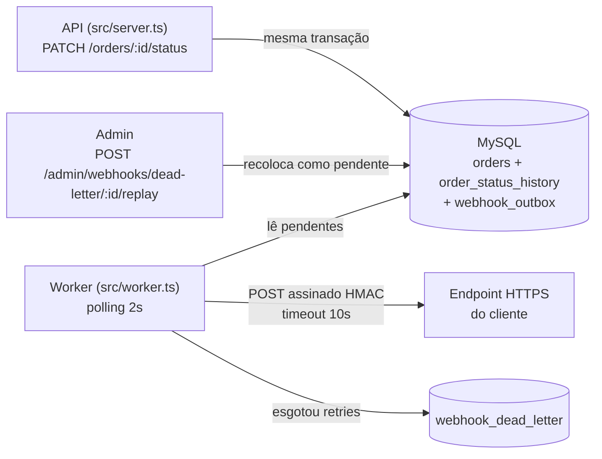

# RFC-001 — Sistema de Webhooks de Notificação de Pedidos

## Metadados

| Campo | Valor |
|---|---|
| **Autora** | Larissa (Tech Lead) |
| **Status** | Em revisão |
| **Data** | 2026-10-24 (consolidação da reunião técnica de quinta-feira, ver `TRANSCRICAO.md`) |
| **Revisores** | Marcos (PM), Bruno (Eng. Pleno, Pedidos), Diego (Eng. Sênior, Plataforma), Sofia (Eng. de Segurança) |
| **Documentos relacionados** | [PRD](PRD.md) · [FDD](FDD.md) · [ADRs](adrs/) · [Tracker](TRACKER.md) |

## 1. TL;DR

Propomos notificar clientes B2B por **webhooks HTTP de saída** sempre que o status de um pedido muda. O evento é gravado numa **tabela outbox no MySQL, na mesma transação** da mudança de status. Um **worker em processo separado** lê a outbox a cada **2 segundos** e entrega o evento assinado com **HMAC-SHA256** (secret por endpoint). Falhas entram em **retry com backoff exponencial** (1m/5m/30m/2h/12h) e, ao esgotar, vão para uma **DLQ** com replay manual por administradores. A garantia é **at-least-once**, com deduplicação pelo cliente via `X-Event-Id`. Tudo reaproveita os padrões atuais do OMS e não exige infraestrutura nova.

## 2. Contexto e problema

Atlas Comercial, MaxDistribuição e Nova Cargo pediram formalmente para ser avisados quando o status dos seus pedidos muda. Hoje elas fazem polling periódico em `GET /orders`, o que deixa a integração "lenta e cara" para elas. A Atlas sinalizou que pode migrar para um concorrente se a entrega não sair até o fim do trimestre ([09:00] Marcos). Para os clientes, "tempo real" é **menos de 10 segundos** ([09:02] Marcos). O fluxo é só de saída ([09:02] Marcos).

O OMS não tem nenhum mecanismo de eventos, filas ou notificação externa. Toda mudança de status passa por `OrderService.changeStatus` (`src/modules/orders/order.service.ts`), uma transação que já atualiza `orders`, grava `order_status_history` e mexe em estoque ([09:04] Bruno). Qualquer solução precisa garantir que **status alterado implica evento registrado** e que **cliente externo lento ou fora do ar não afeta a mudança de status**.

## 3. Proposta técnica

**Componentes**

1. **Configuração de webhooks (API).** Novo módulo `src/modules/webhooks/` com CRUD autenticado. Cada endpoint tem URL `https`, uma secret única gerada pela plataforma, o customer dono, a lista de status assinados e o estado ativo. Inclui rotação de secret e consulta do histórico de entregas ([09:21], [09:31]–[09:34]).
2. **Publicação transacional.** `changeStatus` chama `publishWebhookEvent(tx, order, fromStatus, toStatus)` dentro da transação. A função grava na outbox um snapshot do evento apenas para os webhooks que assinam aquele status ([ADR-001](adrs/ADR-001-outbox-transacional-no-mysql.md), [ADR-007](adrs/ADR-007-payload-snapshot-enxuto-filtrado-na-insercao.md)).
3. **Worker de entrega.** Um processo Node separado, com o mesmo banco e um `PrismaClient` próprio. Faz polling a cada 2s em ordem de criação, assina e envia ([ADR-002](adrs/ADR-002-worker-separado-com-polling.md), [ADR-004](adrs/ADR-004-hmac-sha256-com-secret-por-endpoint.md)).
4. **Resiliência.** Retry com backoff e teto de tentativas. Depois disso, DLQ em tabela própria, com replay manual restrito a `ADMIN` e auditado ([ADR-003](adrs/ADR-003-retry-backoff-exponencial-e-dlq.md)).
5. **Contrato com o cliente.** Payload JSON enxuto (sem itens), headers de identificação e assinatura, semântica at-least-once ([ADR-005](adrs/ADR-005-entrega-at-least-once-com-x-event-id.md)).

**Princípios**

- Nenhuma infraestrutura nova: MySQL, Prisma, Pino e Express já existentes ([ADR-006](adrs/ADR-006-reuso-dos-padroes-do-projeto.md)).
- Ordem garantida só por pedido e só enquanto houver um único worker ([09:13] Larissa).
- Segurança por padrão: TLS obrigatório, HMAC, secret por endpoint, limite de 64KB ([09:19]–[09:23] Sofia).

Endpoints, modelo de dados, máquina de estados da outbox, matriz de erros e observabilidade estão especificados no [FDD](FDD.md).

## 4. Alternativas consideradas

| # | Alternativa | Trade-off que levou ao descarte | Origem |
|---|---|---|---|
| ALT-01 | **Chamada HTTP síncrona dentro de `changeStatus`** | Acopla a latência e a disponibilidade do cliente à transação crítica: um cliente lento trava outras mudanças de status, e um cliente fora do ar obrigaria a um rollback que não faz sentido. | [09:04] Bruno, [09:06] Diego |
| ALT-02 | **Redis Streams / fila externa** | Resolveria o desacoplamento, mas exige operar mais infraestrutura (Redis Cluster). Para um time pequeno é overengineering. *Análise complementar, não dita na reunião:* também se perderia a atomicidade com a transação MySQL. | [09:07] Larissa, [09:07] Diego |
| ALT-03 | **Trigger de banco para um consumo reativo** | O MySQL não tem `LISTEN/NOTIFY` e a trigger não notifica processo externo. Exigiria gambiarras para pouco ganho, já que o polling de 2s atende os 10s. | [09:09] Bruno, [09:09] Diego |
| ALT-04 | **Worker dentro do processo da API** | Um restart da API derrubaria o worker. | [09:11] Diego |
| ALT-05 | **Retry indefinido / apenas 3 tentativas** | Indefinido deixa eventos pendurados para sempre. Três tentativas se esgotam em cerca de 30 min, menos do que indisponibilidades já observadas (2h). | [09:15]–[09:16] Diego |
| ALT-06 | **Secret global da plataforma** | Se vaza uma, vaza tudo. | [09:21] Sofia |
| ALT-07 | **Exactly-once** | Exigiria coordenação dos dois lados e fica muito mais complexo. At-least-once com `event_id` resolve a grande maioria dos casos. | [09:25] Diego |

## 5. Questões em aberto

| # | Questão | Situação | Origem |
|---|---|---|---|
| Q-01 | **Rate limiting de saída por cliente** (por exemplo, 50 mudanças em 1 min geram 50 chamadas) | Fora do escopo. "Observar e decidir depois." | [09:38] Diego, [09:39] Larissa |
| Q-02 | **Aviso ao cliente quando o webhook falha repetidamente** (e-mail) | Adiado para a próxima fase, depois de medir o impacto. | [09:37] Marcos, [09:37] Larissa |
| Q-03 | **Escalar para múltiplos workers** sem perder a ordem por pedido (particionar por `order_id` ou lock pessimista) | Problema futuro, documentado como limitação. | [09:13] Diego, [09:13] Larissa |
| Q-04 | **Endurecer a autorização do CRUD de webhooks** (hoje, qualquer role autenticada) | "Mais pra frente a gente pode endurecer." No código, `User` não tem vínculo com `Customer` (`prisma/schema.prisma`). | [09:37] Sofia |
| Q-05 | **`customer_id` no body ou no path** dos endpoints de configuração | A reunião definiu só que ele não vem do JWT. O FDD propõe body na criação e path na listagem (`/customers/:customerId/webhooks`). A validar com o time. | [09:32] Larissa |
| Q-06 | **Contagem de tentativas**: "5 tentativas" incluem o envio inicial? | Os cinco intervalos decididos só cabem em 1 envio + 5 retentativas (cálculo em [ADR-003](adrs/ADR-003-retry-backoff-exponencial-e-dlq.md)). Ler "5 no total" descartaria o intervalo de 12h, que foi decidido explicitamente. O FDD adota 5 retentativas após o envio inicial. Confirmar. | [09:17] Diego, [09:48] Larissa |
| Q-07 | **Assinatura durante o grace period de 24h da rotação** e **proteção da secret em repouso** | A decisão de alto nível está tomada. A mecânica fica para a revisão de segurança. | [09:21] Sofia, [09:46] Sofia |
| Q-08 | **Retry × ordem por pedido**: um evento em backoff pode ser ultrapassado por um evento posterior do mesmo pedido | A garantia de ordem foi discutida só para o caso feliz. A interação com o retry fica para a sessão de revisão do design. | [09:12] Diego, [09:50] Larissa |

## 6. Impacto e riscos

**Impacto**

- **Código:** um novo módulo (`src/modules/webhooks/`) e um novo entry-point (`src/worker.ts`). Uma única regra de negócio existente muda: `changeStatus` (`src/modules/orders/order.service.ts`) passa a chamar `publishWebhookEvent`. Os demais toques em arquivos existentes são de configuração: registro de rotas, redaction do logger, schema Prisma e scripts. A lista completa está no [FDD §10](FDD.md#10-integração-com-o-sistema-existente).
- **Banco:** novas tabelas de configuração, outbox, entregas e dead letter, via migration Prisma.
- **Operação:** um novo processo para implantar e monitorar (`npm run worker`).
- **Prazo:** três sprints, incluindo pelo menos dois dias úteis de revisão de segurança da Sofia antes do deploy ([09:46] Larissa, [09:46] Sofia). Meta da Atlas: fim de novembro ([09:45] Marcos).

**Riscos arquiteturais.** Os riscos de produto estão no [PRD §10](PRD.md#10-riscos-e-mitigação) e os de implementação no [FDD §13](FDD.md#13-riscos-e-mitigação).

| Risco | Mitigação |
|---|---|
| Mais carga na transação crítica de `changeStatus` | O impacto se limita a uma leitura e um `INSERT` locais ao MySQL, sem I/O externo ([09:04] Bruno). Medir antes e depois. |
| Ponto único de processamento (single-worker) | Os eventos não se perdem se o worker parar, só atrasam. Escalar depende de Q-03 ([09:13] Diego). |
| A semântica at-least-once depende do cliente | Contrato explícito e portal do desenvolvedor ([09:26] Marcos). |

## 7. Decisões relacionadas

| ADR | Decisão |
|---|---|
| [ADR-001](adrs/ADR-001-outbox-transacional-no-mysql.md) | Padrão Outbox transacional no MySQL existente |
| [ADR-002](adrs/ADR-002-worker-separado-com-polling.md) | Worker em processo separado, polling de 2s, ordem por `order_id` |
| [ADR-003](adrs/ADR-003-retry-backoff-exponencial-e-dlq.md) | Retry com backoff 1m/5m/30m/2h/12h e DLQ em tabela separada |
| [ADR-004](adrs/ADR-004-hmac-sha256-com-secret-por-endpoint.md) | HMAC-SHA256 com secret por endpoint e rotação com grace period de 24h |
| [ADR-005](adrs/ADR-005-entrega-at-least-once-com-x-event-id.md) | At-least-once com deduplicação via `X-Event-Id` |
| [ADR-006](adrs/ADR-006-reuso-dos-padroes-do-projeto.md) | Reuso dos padrões existentes do projeto |
| [ADR-007](adrs/ADR-007-payload-snapshot-enxuto-filtrado-na-insercao.md) | Payload enxuto, snapshot e filtro na inserção |
